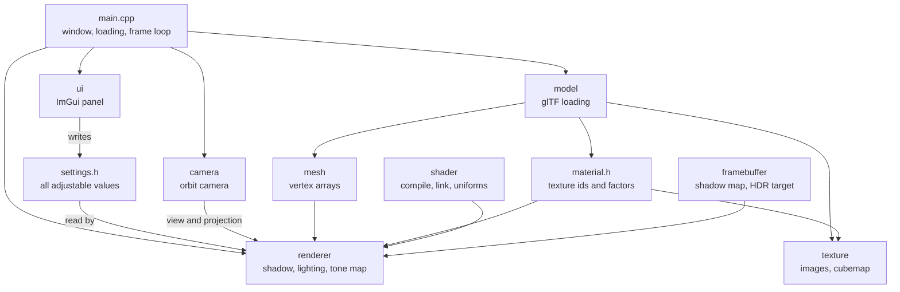
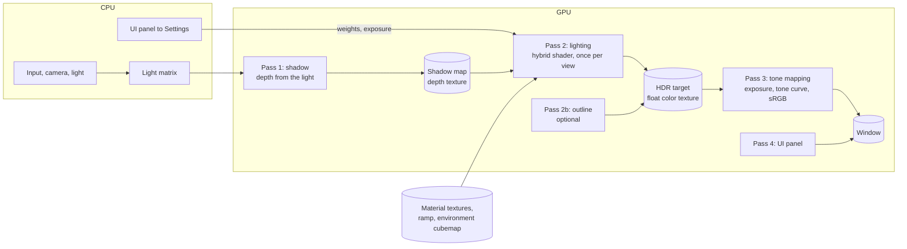

# Architecture overview

How the viewer is put together, written so that either of us can explain it out loud. This is the
planned design. Update it when the code changes shape.

Terms the course did not cover are explained in the [glossary](#glossary) at the end.

## 1. The idea in one paragraph

The program loads a model, then draws it every frame in three passes: a shadow pass, a lighting
pass and a tone mapping pass. All of the interesting work is in the lighting pass, in one fragment
shader. That shader computes every lighting term twice, once the physical way and once the stylized
way, and then mixes the two results with a weight per term. Pure PBR is all weights at 0, pure NPR
is all weights at 1, and the hybrid is whatever the sliders say. The side-by-side view is the same
scene drawn three times with three sets of weights.

## 2. Modules

Each module is one `.h` and `.cpp` pair in `src/`. There is no scene graph, no entity system and no
material class hierarchy.

| Module | Responsible for | Hands on |
|---|---|---|
| `main.cpp` | Creates the window, loads everything once, runs the frame loop | Calls the modules below in order |
| `settings.h` | One plain struct with every value the UI can change: blend weights, light direction, exposure, ramp choice, view mode, debug view | Read by the renderer, written by the UI |
| `camera` | Orbit camera: turns mouse input into a view matrix and a projection matrix | Two matrices to the renderer |
| `shader` | Reads GLSL files, joins them, compiles, links, reports errors, sets uniforms, reloads on request | A program id |
| `texture` | Loads images with stb_image and creates GPU textures with the right color space. Builds the environment cubemap | Texture ids |
| `mesh` | Holds one vertex array (positions, normals, UVs) and draws it. Can generate a sphere | A drawable mesh |
| `model` | Reads a model file with Assimp (glTF first, but OBJ and FBX work too) and turns it into meshes and materials | A list of mesh and material pairs |
| `material.h` | A plain struct: the texture ids and constant factors for one material | Bound by the renderer before drawing |
| `framebuffer` | Creates the two off-screen targets: the shadow depth map and the HDR color target | Framebuffer and texture ids |
| `renderer` | Runs the three passes for one frame | The final image on screen |
| `ui` | Draws the ImGui control panel | Changes to `Settings` |



The shaders live in `shaders/` as separate files:

| File | Contents |
|---|---|
| `mesh.vert` | Vertex shader for the lighting pass |
| `common.glsl` | Uniforms, the `Surface` and `Light` structs, texture reading |
| `pbr_terms.glsl` | The physical version of each lighting term |
| `npr_terms.glsl` | The stylized version of each lighting term |
| `hybrid_main.glsl` | `main()`: builds the inputs, calls both versions, blends, debug views |
| `shadow_depth.vert`, `shadow_depth.frag` | Shadow pass |
| `fullscreen.vert`, `tonemap.frag` | Tone mapping pass |
| `skybox.vert`, `skybox.frag` | Background |
| `outline.vert`, `outline.frag` | Optional outline pass |

GLSL has no `#include`. The `shader` module joins `common.glsl`, `pbr_terms.glsl`, `npr_terms.glsl`
and `hybrid_main.glsl` in that order into one fragment shader. The split exists so that the two of
us can each work in our own file.

## 3. One frame, step by step

### On the CPU

1. Read mouse and keyboard input. Update the camera and the light direction.
2. Build the control panel. Slider changes go into `Settings`.
3. Compute the light's view-projection matrix: an orthographic box that looks along the light
   direction and encloses the model.

### On the GPU

| Pass | Draws | Reads | Writes into |
|---|---|---|---|
| 1. Shadow | The model, seen from the light, depth only | Vertex positions, light matrix | Shadow map: a 2048 x 2048 depth texture |
| 2. Lighting | The model with the hybrid shader, once per view. Then the skybox | Material textures, shadow map, environment cubemap, ramp texture, camera and light uniforms, blend weights | HDR target: a 16-bit float color texture the size of the window, plus a depth buffer |
| 2b. Outline (optional) | The model again, slightly enlarged, back faces only, in a flat color | Vertex positions and normals | The same HDR target |
| 3. Tone mapping | One triangle that covers the screen | The HDR color texture, exposure | The window's own framebuffer |
| 4. UI | The ImGui panel | ImGui draw data | The window's own framebuffer |



### The side-by-side view

In pass 2 the window is split into three vertical strips with `glViewport` and `glScissor`. The
model is drawn once into each strip with the same camera and light. Only the four weights differ:
all 0 for PBR, the slider values for the hybrid, all 1 for NPR. The shadow pass runs once and is
shared. Drawing the scene three times is wasteful, but our scenes are one model, and it means the
comparison needs no extra shader code.

### Color space rule

All lighting math happens in linear color. Three places enforce this, and nowhere else touches it:

1. **Loading.** Base color and ramp textures are created with an sRGB format, so the GPU converts
   them to linear when the shader reads them. Metallic, roughness and normal textures hold data,
   not colors, and are created with a linear format. The environment map is a float texture that is
   already linear.
2. **Lighting.** The HDR target stores linear values, including values above 1.
3. **Tone mapping.** The last shader applies exposure, a tone curve that brings bright values into
   the 0 to 1 range, and then the linear to sRGB conversion. `GL_FRAMEBUFFER_SRGB` stays off, so
   the conversion happens exactly once and ImGui is drawn afterward untouched.

## 4. Data flow for one material

```
Files on disk           model.gltf or .glb, with its images
                        or a folder of loose textures (base color, roughness, metallic)
        |
        v  model + texture modules, on the CPU, once at startup
Loaded data             Mesh: positions, normals, UVs, indices
                        Material: base color texture (sRGB), metallic-roughness texture (linear),
                        constant factors
        |
        v  uploaded to the GPU once
GPU objects             Vertex array with attributes 0 position, 1 normal, 2 UV
                        2D textures
        |
        v  renderer, every frame, before drawing the mesh
Uniforms and bindings   Matrices: model, view, projection, light
                        Camera position, light direction, color and intensity
                        Texture units: 0 base color, 1 metallic-roughness, 2 normal (optional),
                        3 shadow map, 4 environment cubemap, 5 ramp
                        Four blend weights, stylized parameters, debug view number
        |
        v  mesh.vert, per vertex
Passed to fragments     World position, world normal, UV, position in light space
        |
        v  hybrid shader, per pixel
Linear HDR color        Written to the HDR target
        |
        v  tonemap.frag
Final pixel             sRGB color in the window
```

glTF stores roughness in the green channel and metallic in the blue channel of one texture. Loose
texture sets that come as separate roughness and metallic images are packed into that same layout
when they are loaded, so the shader only ever sees one layout.

## 5. Inside the hybrid shader

### Inputs every term receives

`hybrid_main.glsl` builds two structs once per pixel and passes them to every term function.

```glsl
struct Surface {
  vec3 position;    // world space
  vec3 N;           // unit surface normal
  vec3 V;           // unit direction from the surface to the camera
  vec3 baseColor;   // linear
  float metallic;   // 0 non-metal, 1 metal
  float roughness;  // 0 mirror, 1 fully rough
};

struct Light {
  vec3 L;           // unit direction from the surface to the light
  vec3 radiance;    // light color times intensity, linear
};
```

### Two versions of each term, one interface

| Term | Physical version, in `pbr_terms.glsl` | Stylized version, in `npr_terms.glsl` |
|---|---|---|
| Shadow: `float shadow*(float visibility)` | Returns the filtered shadow map result as is: a soft edge | Sharpens it into a hard edge with an adjustable threshold |
| Diffuse: `vec3 diffuse*(Surface s, Light l, float shadow)` | Lambert: base color / pi, times N.L, times shadow | Looks up the ramp at `(N.L * 0.5 + 0.5) * shadow`. The shadow moves the lookup position. It is not multiplied on afterward |
| Specular: `vec3 specular*(Surface s, Light l, float shadow)` | Cook-Torrance: GGX, Smith, Schlick Fresnel, times N.L, times shadow | The GGX term divided by its own peak, cut at a threshold. The result is a flat highlight whose size grows with roughness |
| Ambient: `vec3 ambient*(Surface s)` | Environment lighting: a very blurred cubemap sample along N for diffuse, plus a cubemap sample along the reflection direction at a mip level chosen by roughness | A flat ambient color times the base color |

The shadow map lookup itself (the depth comparison and the 3 x 3 filtering) is shared code in
`common.glsl`. It produces `visibility`, a number from 0 (in shadow) to 1 (lit).

### Blending

```glsl
float shadow = mix(shadowPhysical(vis),          shadowStylized(vis),          uWeightShadow);
vec3 diffuse  = mix(diffusePhysical(s, l, shadow),  diffuseStylized(s, l, shadow),  uWeightDiffuse);
vec3 specular = mix(specularPhysical(s, l, shadow), specularStylized(s, l, shadow), uWeightSpecular);
vec3 ambient  = mix(ambientPhysical(s),             ambientStylized(s),             uWeightAmbient);
fragColor = vec4(diffuse + specular + ambient, 1.0);
```

A weight of 0 is physical and 1 is stylized. Both versions are always computed. That costs a little
GPU time and keeps the shader free of branches, so any mix can be dialed in while the program runs.

The view modes are not in the shader. The renderer picks which weights to send: zeros, ones, or the
slider values.

A `uDebugView` uniform makes the shader output one thing on its own: base color, metallic,
roughness, the normal, shadow visibility, or a single lighting term. We use this to check our work
against a reference viewer one input at a time.

### Keeping the two sides comparable

Both diffuse versions use the same light and the same base color / pi factor. The ramp only replaces
the N.L factor. A white ramp gives the same brightness the physical side has where the surface
faces the light directly, so the two sides stay in the same range and differences on screen come
from the shading model, not from mismatched brightness.

## 6. Why it is arranged this way

- **One forward lighting pass.** We have one light and one model. Deferred shading would add several
  more render targets to explain and debug for no benefit here.
- **Terms as separate functions with a fixed interface.** The project asks which combinations look
  good. A new idea should mean changing one function, and the blend code should never need to
  change.
- **Shader split into files by side.** Two people can work on the physical and stylized sides at
  the same time without editing the same file.
- **One `Settings` struct.** Every adjustable value is in one place, so the UI and the renderer
  cannot disagree and a new slider is two lines.
- **OpenGL 4.1 core.** It is the newest version that runs on macOS, so the same code builds on every
  platform.

Kept simple on purpose:

- One directional light. No point lights or light lists.
- Environment reflections use the cubemap's ordinary mip chain, picked by roughness. This is blurry
  in roughly the right way and takes a few lines. The accurate method, split-sum prefiltering, is
  an optional later step.
- One fixed shadow map that encloses the model. No cascades.
- The scene is drawn three times for the comparison view, not composited in a cleverer way.
- No hot paths are optimized. The target is one model at interactive frame rates.
- Loading supports what our test assets need from glTF: triangles, positions, normals, one UV set
  and the metallic-roughness material. No animation, skinning or cameras.

## Glossary

- **PBR, physically based rendering.** Shading that follows measured rules of how light reflects, so
  a material looks right under any lighting.
- **NPR, non-photorealistic rendering.** Shading that aims for a drawn or painted look instead.
- **BRDF.** A function that says how much light arriving from one direction leaves a surface toward
  another direction. Phong is a simple BRDF.
- **Microfacet model, Cook-Torrance.** Treats a surface as many tiny mirrors. Three parts: **D**
  (GGX) says how many tiny mirrors face the right way, **G** (Smith) says how many are hidden by
  their neighbors, **F** (Fresnel, Schlick's approximation) says how reflective they are at this
  viewing angle.
- **Metallic and roughness.** The two numbers that describe a PBR material besides its base color.
  Metals have no diffuse color and tint their reflections. Rough surfaces have wide, dim highlights.
- **Linear and sRGB.** Image files store colors on a curve (sRGB) that suits displays. Lighting math
  is only correct on values proportional to light energy (linear). Convert on the way in and on the
  way out.
- **HDR, high dynamic range.** Storing colors as floats that can exceed 1, so bright highlights are
  not clipped during lighting.
- **Tone mapping.** Squeezing HDR values into the 0 to 1 range a display can show.
- **Framebuffer.** An off-screen image the GPU can draw into. Its textures can be read by a later
  pass.
- **Shadow map.** A depth image drawn from the light. A pixel is in shadow if it is farther from the
  light than the depth stored there.
- **PCF, percentage closer filtering.** Averaging several shadow comparisons around a pixel to
  soften the shadow edge.
- **Shadow acne.** Speckled false shadows on lit surfaces, caused by limited depth precision. Fixed
  with a small depth offset called a bias.
- **Cubemap.** Six square textures arranged as a cube and looked up with a direction. Used for the
  environment.
- **Mip level.** A smaller, blurrier copy of a texture. Higher levels are blurrier.
- **Ramp.** A 1D texture of colors. The stylized diffuse uses a brightness value as the position to
  read from it, which turns smooth shading into bands.
- **Inverted hull.** An outline method: draw the model again slightly enlarged, showing only its
  back faces, in the outline color.
